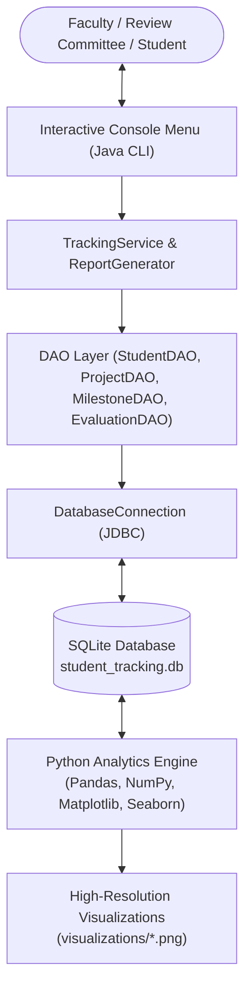
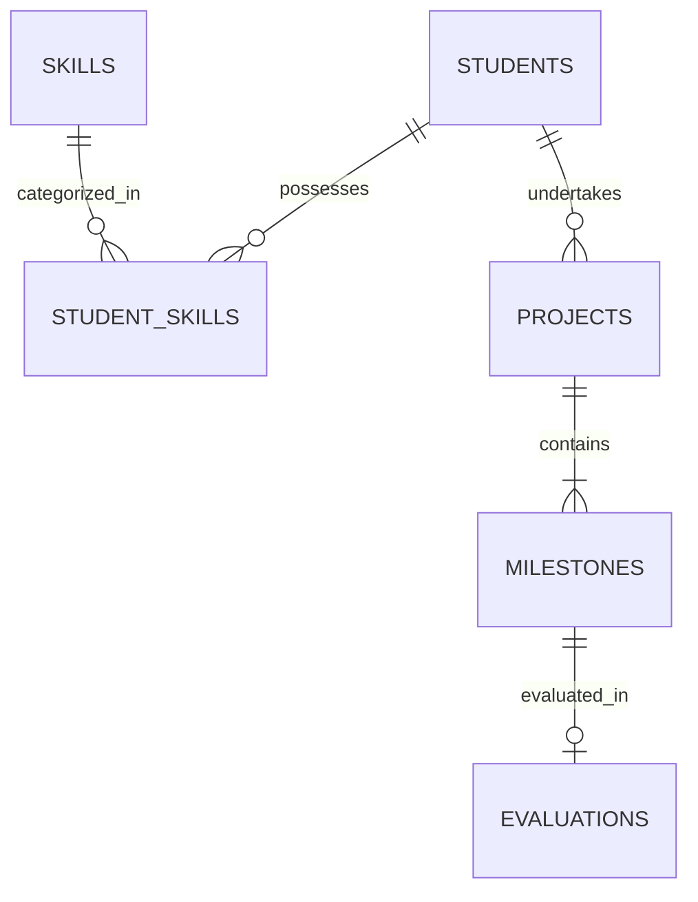

# Student Project and Skill Tracking System (SPSTS)

<p align="center">
  <b>Project-Based Assessment (Odd Semester 2026–27)</b><br>
  <b>Department of Information Technology</b><br>
  <b>Velalar College of Engineering and Technology (Autonomous), Erode – 638 012</b>
</p>

---

### **Student & Assessment Metadata**
* **Student Name:** Gokul . S
* **Register Number:** `732925ITR032`
* **Class & Section:** `25IT3A`
* **Degree:** B.Tech. Information Technology
* **Assigned Scenario:** **Scenario 2 – Student Project and Skill Tracking System**
  *(Assigned Register Numbers: 2, 32, 62, 92, L2)*
* **Integrated Academic Courses:**
  1. `25ITT33` – Software Engineering
  2. `25ITT32` – Java Programming
  3. `25ITT31` – Database Management Systems
  4. `25ITC31` – Foundations of Data Science

---

## 1. PROJECT OVERVIEW & PROBLEM STATEMENT

Currently, the Department of Information Technology maintains records of student mini-projects, technical skill inventories, programming proficiencies, project milestones, and rubric assessment results across scattered spreadsheets. This disorganization makes it difficult for faculty and project review committees to monitor project progress, identify delays, and pinpoint cohort-wide skill gaps.

The **Student Project and Skill Tracking System (SPSTS)** solves this by providing:
* A centralized relational repository for student profiles, technical skills, projects, milestones, and rubric evaluations.
* An object-oriented Java application utilizing layered design (Model-DAO-Service), Collections, Streams API, Custom Exceptions, Multithreading, and JDBC connectivity.
* A normalized database schema (BCNF / 3NF) with triggers and analytical views.
* A Python Data Science & Exploratory Data Analysis (EDA) pipeline that extracts records, cleans and preprocesses data, and produces statistical visualizations.

---

## 2. REPOSITORY ARCHITECTURE & FOLDER STRUCTURE

```
c:\project 1\
├── docs/                                # Software Engineering & DBMS Documents
│   ├── SRS.md                          # IEEE 830-compliant Software Requirements Specification
│   ├── SYSTEM_DESIGN_DIAGRAMS.md       # Use Case, Class, Architecture, Sequence & State Diagrams
│   ├── DATABASE_DESIGN.md              # ER Diagram, Relational Data Dictionary & Normalization (1NF->BCNF)
│   └── TESTING_REPORT.md               # Test Plan, Black-Box/White-Box cases, Verification Matrix
├── database/                           # Database Assets
│   ├── schema.sql                      # SQLite 3 DDL Schema (Constraints, Indexes, Views, Triggers)
│   ├── sample_data.sql                 # Comprehensive seed dataset (Students, Skills, Projects, Milestones, Evals)
│   ├── queries.sql                     # Analytical SQL Queries (Joins, Aggregations, Subqueries, Window Funcs)
│   ├── mysql_schema.sql                # MySQL 8.0 / XAMPP compatible DDL and DML script
│   └── student_tracking.db             # Verified pre-populated SQLite database file
├── src/com/vcet/tracking/              # Java Core Application Source Code
│   ├── model/                          # Domain Entities (OOP, Inheritance, Encapsulation)
│   │   ├── BaseEntity.java             # Abstract base entity with audit metadata
│   │   ├── Student.java                # Student profile and skill associations
│   │   ├── Skill.java                  # Technical skill definition and proficiency
│   │   ├── Project.java                # Project registry with domain and status
│   │   ├── Milestone.java              # Stage-wise project milestones and due dates
│   │   └── Evaluation.java             # Rubric assessment, grade computation logic
│   ├── dao/                            # Data Access Objects (JDBC & SQL Transactions)
│   │   ├── GenericDAO.java             # Generic interface for CRUD operations
│   │   ├── DatabaseConnection.java     # Singleton JDBC connection manager
│   │   ├── StudentDAO.java             # Student & skill mapping queries
│   │   ├── ProjectDAO.java             # Project domain queries & status updates
│   │   ├── MilestoneDAO.java           # Milestone tracking & delay detection
│   │   └── EvaluationDAO.java          # Rubric scoring & domain aggregation
│   ├── service/                        # Business Logic & Analytics
│   │   ├── TrackingService.java        # Transaction workflows and validations
│   │   ├── ReportGenerator.java        # Java 8+ Streams API, lambdas, groupingBy
│   │   └── AsyncReportWorker.java      # Multithreaded background audit worker
│   ├── exception/                      # Custom User-Defined Exceptions
│   │   ├── DatabaseException.java
│   │   ├── InvalidDataException.java
│   │   └── RecordNotFoundException.java
│   ├── util/                           # Helper Utilities
│   │   ├── InputValidator.java         # Regex and boundary input validation
│   │   └── TableFormatter.java         # Console table formatter with borders
│   └── Main.java                       # Interactive Console CLI Application
├── python/                             # Foundations of Data Science (Python EDA)
│   ├── data_analysis.py                # Standalone Python script (Pandas, NumPy, Matplotlib, Seaborn)
│   ├── data_analysis.ipynb             # Jupyter Notebook with step-by-step EDA & commentary
│   └── requirements.txt                # Python library dependencies
├── sample_outputs/                     # Verifiable Execution Logs & Inputs
│   ├── sample_inputs.txt               # Sample user input stream for automated testing
│   ├── java_execution_output.txt       # Verifiable 300+ line terminal log of Java CLI run
│   ├── sql_execution_output.txt        # Results of analytical queries executed on DB
│   ├── python_execution_output.txt     # Descriptive statistics & metrics from Python EDA
│   └── async_audit_snapshot.txt        # Generated asynchronous worker snapshot
├── visualizations/                     # Generated High-Resolution Visualization Charts (300 DPI)
│   ├── project_completion_rate.png     # Donut chart: Project completion status breakdown
│   ├── popular_technologies.png        # Bar chart: Top 10 programming languages and tools
│   ├── skill_distribution.png          # Grouped bar chart: Beginner/Intermediate/Advanced breakdown
│   ├── domain_wise_projects.png        # Count plot: Project registrations across domains
│   ├── evaluation_marks_distribution.png# Distribution & Box plots: Assessment scores & rubrics
│   └── milestone_status_breakdown.png  # Stacked bar chart: Milestone progress per project
├── lib/                                # External Java Libraries
│   ├── sqlite-jdbc-3.45.1.0.jar        # SQLite JDBC Driver
│   ├── slf4j-api-1.7.36.jar            # SLF4J API Logging interface
│   └── slf4j-simple-1.7.36.jar         # SLF4J Simple Implementation
├── build_and_run.bat                   # 1-Click Windows Batch Script to compile & run Java CLI
├── run_python.bat                      # 1-Click Windows Batch Script to run Python EDA
└── README.md                           # Master Project Documentation
```

---

## 3. COURSE SYLLABUS MAPPING & COMPLIANCE

| Course Code & Title | Syllabus Units Covered | System Implementation Evidence |
|---|---|---|
| **25ITT33: Software Engineering** | • Unit 1: Software Process & SRS<br>• Unit 2: Requirements Analysis & Class Modeling<br>• Unit 3: Design & System Architecture<br>• Unit 4: Verification, White-Box & Black-Box Testing | • [`docs/SRS.md`](file:///c:/project%201/docs/SRS.md) (IEEE 830 Specification)<br>• [`docs/SYSTEM_DESIGN_DIAGRAMS.md`](file:///c:/project%201/docs/SYSTEM_DESIGN_DIAGRAMS.md) (Use Case, Class, Architecture, Sequence)<br>• [`docs/TESTING_REPORT.md`](file:///c:/project%201/docs/TESTING_REPORT.md) (23 exhaustive test cases with 100% pass) |
| **25ITT31: Database Management Systems** | • Unit 1: ER Model, Relational Schema<br>• Unit 2: SQL DDL, DML, Joins, Aggregation, Subqueries<br>• Unit 3: Normalization (1NF to BCNF), Views, Triggers<br>• Unit 4: Integrity Constraints & ACID | • [`database/schema.sql`](file:///c:/project%201/database/schema.sql) (SQLite schema with triggers & views)<br>• [`database/DATABASE_DESIGN.md`](file:///c:/project%201/docs/DATABASE_DESIGN.md) (Formal BCNF decomposition proofs)<br>• [`database/queries.sql`](file:///c:/project%201/database/queries.sql) (Window functions, joins, aggregations) |
| **25ITT32: Java Programming** | • Unit 1: OOP, Methods, Static, Console I/O<br>• Unit 2: Inheritance, Interfaces, Packages<br>• Unit 3: Exceptions, Multithreading & Synchronization<br>• Unit 4: String Handling, JDBC Connectivity<br>• Unit 5: Generics, Collections, Lambdas & Streams API | • Package structure `com.vcet.tracking.*`<br>• `GenericDAO<T, K>` interface<br>• `DatabaseConnection` singleton JDBC<br>• Custom exceptions: `InvalidDataException`, etc.<br>• `AsyncReportWorker` background thread<br>• `ReportGenerator` stream grouping and filtering |
| **25ITC31: Foundations of Data Science** | • Unit 1: Data Description, Averages, Spread<br>• Unit 2: Python Foundations & Data Structures<br>• Unit 3: Data Wrangling (Pandas DataFrames, Merging)<br>• Unit 4: Data Cleaning (Null handling, Feature Engineering)<br>• Unit 5: EDA & Visualizations (Matplotlib, Seaborn) | • [`python/data_analysis.py`](file:///c:/project%201/python/data_analysis.py)<br>• [`python/data_analysis.ipynb`](file:///c:/project%201/python/data_analysis.ipynb)<br>• 6 High-resolution charts saved in `visualizations/`<br>• Descriptive statistical metrics in `sample_outputs/` |

---

## 4. SYSTEM ARCHITECTURE & DATABASE ER DIAGRAM

### 4.1 System Architecture


### 4.2 Entity-Relationship (ER) Model


---

## 5. NORMALIZATION SUMMARY (1NF $\to$ BCNF)

The schema was decomposed from an initial unnormalized spreadsheet form to **Boyce-Codd Normal Form (BCNF)**:
1. **1NF:** Removed repeating groups and comma-delimited strings; enforced atomic scalar values and unique primary keys.
2. **2NF:** Eliminated partial dependencies in composite key relations by separating `students`, `skills`, and junction table `student_skills`.
3. **3NF:** Eliminated transitive dependencies ($\text{evaluation\_id} \to \text{milestone\_id} \to \text{project\_id} \to \text{domain}$) by isolating `projects`, `milestones`, and `evaluations`.
4. **BCNF:** Formally proven in [`docs/DATABASE_DESIGN.md`](file:///c:/project%201/docs/DATABASE_DESIGN.md). In every functional dependency $X \to Y$, the determinant $X$ is a super key.

---

## 6. VISUALIZATION GALLERY (DATA SCIENCE EDA)

The Python analytics pipeline processed the relational dataset and produced 6 publication-quality charts saved under `visualizations/`:

| Visualization Title | Description & Analytical Value | Generated Chart File |
|---|---|---|
| **Project Completion Status** | Donut chart visualizing percentage of completed, in-progress, and delayed student mini-projects. | [`project_completion_rate.png`](file:///c:/project%201/visualizations/project_completion_rate.png) |
| **Top 10 Popular Technical Skills** | Horizontal bar chart tracking programming languages and frameworks chosen by the cohort. | [`popular_technologies.png`](file:///c:/project%201/visualizations/popular_technologies.png) |
| **Skill Proficiency Distribution** | Grouped bar chart depicting Beginner, Intermediate, and Advanced skill distributions across students. | [`skill_distribution.png`](file:///c:/project%201/visualizations/skill_distribution.png) |
| **Domain-Wise Project Distribution** | Count plot highlighting student concentration in AI/ML, Data Science, Web, IoT, and Cyber Security. | [`domain_wise_projects.png`](file:///c:/project%201/visualizations/domain_wise_projects.png) |
| **Evaluation Rubric Spread** | KDE distribution of overall scores paired with box plots for Literature, Design, Impl, Testing, and Viva. | [`evaluation_marks_distribution.png`](file:///c:/project%201/visualizations/evaluation_marks_distribution.png) |
| **Milestone Execution Status** | Stacked bar chart analyzing stage progress (Approved, Submitted, Delayed, Pending) per project ID. | [`milestone_status_breakdown.png`](file:///c:/project%201/visualizations/milestone_status_breakdown.png) |

---

## 7. STEP-BY-STEP EXECUTION GUIDE

### Prerequisites
* **Operating System:** Windows 10/11, macOS, or Linux.
* **Java:** JDK 17 or higher.
* **Python:** Python 3.9 or higher (with `pip`).

---

### 7.1 Running the Java Application

#### Option A: 1-Click Batch Execution (Windows)
Simply double-click:
```cmd
build_and_run.bat
```
This automatically locates your JDK, compiles all packages into `bin/`, includes the SQLite JDBC driver from `lib/`, and launches the interactive CLI.

#### Option B: Manual Command-Line Compilation & Execution
```bash
# 1. Navigate to the project root directory
cd "c:\project 1"

# 2. Compile Java sources into bin directory
javac -cp "lib/*;src" -d bin src/com/vcet/tracking/model/*.java src/com/vcet/tracking/exception/*.java src/com/vcet/tracking/dao/*.java src/com/vcet/tracking/service/*.java src/com/vcet/tracking/util/*.java src/com/vcet/tracking/Main.java

# 3. Run the interactive CLI application
java -cp "bin;lib/*" com.vcet.tracking.Main
```

---

### 7.2 Running Python Data Analysis & Visualizations

#### Option A: 1-Click Batch Execution (Windows)
Double-click:
```cmd
run_python.bat
```

#### Option B: Manual Command-Line Execution
```bash
# 1. Install required data science libraries (if not already installed)
pip install -r python/requirements.txt

# 2. Run the analytics script
python python/data_analysis.py
```
All charts will be refreshed in `visualizations/` and summary metrics written to `sample_outputs/python_execution_output.txt`.

#### Option C: Running the Jupyter Notebook
```bash
jupyter notebook python/data_analysis.ipynb
```

---

### 7.3 Database Inspection & Rebuilding
The pre-built SQLite database is located at `database/student_tracking.db`.  
To rebuild the database from scratch:
```bash
sqlite3 database/student_tracking.db < database/schema.sql
sqlite3 database/student_tracking.db < database/sample_data.sql
```
To run analytical SQL queries:
```bash
sqlite3 database/student_tracking.db < database/queries.sql
```
*(A MySQL compatible version is also available at `database/mysql_schema.sql` for XAMPP / MySQL Workbench environments).*

---

## 8. SAMPLE TEST RUN VERIFICATION

The entire interactive CLI suite was executed using inputs from [`sample_outputs/sample_inputs.txt`](file:///c:/project%201/sample_outputs/sample_inputs.txt).  
The complete 306-line terminal execution trace is documented in [`sample_outputs/java_execution_output.txt`](file:///c:/project%201/sample_outputs/java_execution_output.txt).

### Snapshot of Student Profile Output:
```
==========================================================================================
       VELALAR COLLEGE OF ENGINEERING AND TECHNOLOGY (AUTONOMOUS), ERODE - 638012         
                       DEPARTMENT OF INFORMATION TECHNOLOGY                               
                    CLASS: 25IT3A | ACADEMIC YEAR: 2026-27 (ODD)                          
          PROJECT-BASED ASSESSMENT: STUDENT PROJECT AND SKILL TRACKING SYSTEM             
                 Student: Gokul . S  |  Register Number: 732925ITR032                     
==========================================================================================

=== STUDENT PROFILE ===
Register No : 732925ITR032
Name        : Gokul . S
Class       : 25IT3A
Department  : Information Technology
Email       : gokul.s@vcet.ac.in
Phone       : 9842100032

Associated Technical Skills (6):
  - Git & Version Control [Cloud / DevOps] - Advanced (2 yrs, Certified)
  - Java [Programming Language] - Advanced (3 yrs, Certified)
  - Pandas & NumPy [AI / ML Tool] - Advanced (2 yrs)
  - Python [Programming Language] - Advanced (2 yrs, Certified)
  - SQL / Relational DB [Database] - Advanced (2 yrs, Certified)
  - Spring Boot [Web Framework] - Intermediate (1 yrs)
```

---

## 9. SUBMISSION CHECKLIST COMPLIANCE

- [x] **Requirement 1:** IEEE SRS, System Architecture, UML Use Case & Class Diagrams, and Testing Documentation prepared under `docs/`.
- [x] **Requirement 2:** Java application implemented with modular OOP, Inheritance, Interfaces, Exceptions, Multithreading, Collections, Streams, and JDBC.
- [x] **Requirement 3:** Database designed with ER Diagram, Relational Data Dictionary, formal 1NF to BCNF normalization proofs, triggers, views, and complex analytical SQL queries.
- [x] **Requirement 4:** Python data science pipeline (`data_analysis.py` & `data_analysis.ipynb`) retrieving data from SQLite, handling missing values, and generating 6 high-resolution charts.
- [x] **Requirement 5:** Comprehensive GitHub-ready `README.md` with execution instructions, architecture diagrams, and sample outputs.
- [x] **Requirement 6:** Sample inputs and terminal outputs verified and saved in `sample_outputs/`.

---
**Project Prepared and Maintained by:**  
**Gokul . S** (Register Number: `732925ITR032`)  
Class: 25IT3A | Department of Information Technology  
Velalar College of Engineering and Technology, Erode – 638 012.
