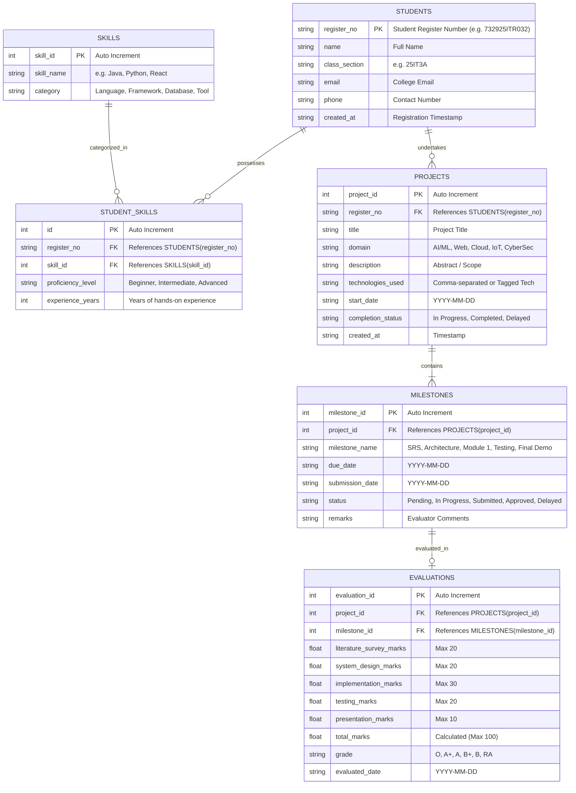

# DATABASE DESIGN AND NORMALIZATION REPORT
## Student Project and Skill Tracking System

* **Student Name:** Gokul . S
* **Register Number:** 732925ITR032
* **Class:** 25IT3A
* **Department:** Information Technology
* **Institution:** Velalar College of Engineering and Technology, Erode – 12
* **Course:** 25ITT31 – Database Management Systems

---

## 1. ENTITY-RELATIONSHIP (ER) DIAGRAM

The ER Model represents the conceptual design of the system, illustrating entities, attributes, primary keys, foreign keys, and cardinalities.

---

## 2. RELATIONAL SCHEMA (DATA DICTIONARY)

### Table 1: `students`
| Column Name | Data Type | Constraints | Description |
|---|---|---|---|
| `register_no` | VARCHAR(15) | PRIMARY KEY | Unique student registration identifier |
| `name` | VARCHAR(100) | NOT NULL | Full student name |
| `class_section` | VARCHAR(10) | NOT NULL | Academic section (e.g., 25IT3A) |
| `email` | VARCHAR(120) | UNIQUE, NOT NULL | Institutional email address |
| `phone` | VARCHAR(15) | NULL | Contact mobile number |
| `created_at` | TIMESTAMP | DEFAULT CURRENT_TIMESTAMP | Registration timestamp |

### Table 2: `skills`
| Column Name | Data Type | Constraints | Description |
|---|---|---|---|
| `skill_id` | INTEGER | PRIMARY KEY AUTOINCREMENT | Unique skill identifier |
| `skill_name` | VARCHAR(50) | UNIQUE, NOT NULL | Name of skill (e.g., Java, Python) |
| `category` | VARCHAR(50) | NOT NULL | Category (Language, Framework, Database, Tool) |

### Table 3: `student_skills`
| Column Name | Data Type | Constraints | Description |
|---|---|---|---|
| `id` | INTEGER | PRIMARY KEY AUTOINCREMENT | Unique mapping identifier |
| `register_no` | VARCHAR(15) | FOREIGN KEY -> students(register_no) ON DELETE CASCADE | Student reference |
| `skill_id` | INTEGER | FOREIGN KEY -> skills(skill_id) ON DELETE CASCADE | Skill reference |
| `proficiency_level`| VARCHAR(20) | CHECK(proficiency_level IN ('Beginner', 'Intermediate', 'Advanced')) | Skill proficiency rating |
| `experience_years` | INTEGER | CHECK(experience_years >= 0) | Hands-on experience in years |
| *Composite Unique* | (register_no, skill_id) | UNIQUE | Prevents duplicate skill assignment |

### Table 4: `projects`
| Column Name | Data Type | Constraints | Description |
|---|---|---|---|
| `project_id` | INTEGER | PRIMARY KEY AUTOINCREMENT | Unique project identifier |
| `register_no` | VARCHAR(15) | FOREIGN KEY -> students(register_no) ON DELETE RESTRICT | Project author/student |
| `title` | VARCHAR(255) | NOT NULL | Project title |
| `domain` | VARCHAR(50) | NOT NULL | Domain (Data Science, Web, IoT, AI/ML, Cloud) |
| `description` | TEXT | NULL | Project abstract / summary |
| `technologies_used`| VARCHAR(255) | NOT NULL | Comma-separated tech stack |
| `start_date` | DATE | NOT NULL | Project inception date |
| `completion_status`| VARCHAR(20) | CHECK(completion_status IN ('In Progress', 'Completed', 'Delayed')) | Overall status |
| `created_at` | TIMESTAMP | DEFAULT CURRENT_TIMESTAMP | Record creation timestamp |

### Table 5: `milestones`
| Column Name | Data Type | Constraints | Description |
|---|---|---|---|
| `milestone_id` | INTEGER | PRIMARY KEY AUTOINCREMENT | Unique milestone identifier |
| `project_id` | INTEGER | FOREIGN KEY -> projects(project_id) ON DELETE CASCADE | Associated project |
| `milestone_name` | VARCHAR(100) | NOT NULL | Milestone name (e.g., SRS, Design) |
| `due_date` | DATE | NOT NULL | Scheduled deadline date |
| `submission_date` | DATE | NULL | Date student submitted deliverable |
| `status` | VARCHAR(20) | CHECK(status IN ('Pending', 'In Progress', 'Submitted', 'Approved', 'Delayed')) | Stage status |
| `remarks` | TEXT | NULL | Faculty remarks / notes |

### Table 6: `evaluations`
| Column Name | Data Type | Constraints | Description |
|---|---|---|---|
| `evaluation_id` | INTEGER | PRIMARY KEY AUTOINCREMENT | Unique evaluation identifier |
| `project_id` | INTEGER | FOREIGN KEY -> projects(project_id) ON DELETE CASCADE | Evaluated project |
| `milestone_id` | INTEGER | FOREIGN KEY -> milestones(milestone_id) ON DELETE CASCADE | Associated milestone |
| `literature_survey_marks` | NUMERIC(5,2) | CHECK(literature_survey_marks BETWEEN 0 AND 20) | Literature review marks |
| `system_design_marks` | NUMERIC(5,2) | CHECK(system_design_marks BETWEEN 0 AND 20) | Architecture & Design marks |
| `implementation_marks` | NUMERIC(5,2) | CHECK(implementation_marks BETWEEN 0 AND 30) | Code Quality & Logic marks |
| `testing_marks` | NUMERIC(5,2) | CHECK(testing_marks BETWEEN 0 AND 20) | Test cases & Validation marks |
| `presentation_marks` | NUMERIC(5,2) | CHECK(presentation_marks BETWEEN 0 AND 10) | Presentation & Viva marks |
| `total_marks` | NUMERIC(5,2) | Generated/Calculated Column | Total score out of 100 |
| `grade` | VARCHAR(5) | CHECK(grade IN ('O', 'A+', 'A', 'B+', 'B', 'RA')) | Letter grade |
| `evaluated_date` | DATE | DEFAULT CURRENT_DATE | Date evaluation was recorded |

---

## 3. NORMALIZATION PROCESS (1NF TO BCNF)

### 3.1 Initial Unnormalized Form (UNF)
In legacy spreadsheet tracking, all records were kept in a single massive flat sheet:
$$\text{UNF}(\underline{\text{RegNo}}, \text{Name}, \text{Class}, \text{Email}, \text{Skills}, \text{Proficiencies}, \text{ProjectTitle}, \text{Domain}, \text{TechStack}, \text{MilestoneNames}, \text{DueDates}, \text{SubDates}, \text{ComponentMarks})$$

* **Anomalies in UNF:**
  * **Insertion Anomaly:** Cannot record a new skill (e.g. *Docker*) or student without creating a dummy project.
  * **Deletion Anomaly:** Deleting a project wipes out the student's technical skill profile.
  * **Update Anomaly:** If a student updates their email or section, multiple rows across different milestones must be manually updated.

---

### 3.2 First Normal Form (1NF)
* **Rule:** A relation is in 1NF if every attribute contains only atomic (indivisible) values, and there are no repeating groups.
* **Transformation:** Multivalued attributes such as `Skills` (e.g., "Java, Python, React") and repeating `Milestones` are decomposed into separate rows. Every column contains atomic scalar values, and a composite primary key is established:
  * Decomposed into entity candidate relations: `Students`, `Skills`, `Projects`, `Milestones`.

---

### 3.3 Second Normal Form (2NF)
* **Rule:** A relation is in 2NF if it is in 1NF and no non-prime attribute is partially dependent on any candidate key (elimination of partial functional dependencies).
* **Analysis:**
  * In `Student_Skills(register_no, skill_id, student_name, skill_name, proficiency_level)`:
    * The primary key is `(register_no, skill_id)`.
    * Dependency $\text{register\_no} \to \text{student\_name}$ is a partial dependency because $\text{student\_name}$ depends only on part of the composite key.
    * Dependency $\text{skill\_id} \to \text{skill\_name}$ is also a partial dependency.
* **Resolution:**
  * Decomposed into:
    * `STUDENTS(register_no, name, class_section, email, phone)`
    * `SKILLS(skill_id, skill_name, category)`
    * `STUDENT_SKILLS(id, register_no, skill_id, proficiency_level, experience_years)`
  * All non-key attributes are now fully functionally dependent on the entire primary key.

---

### 3.4 Third Normal Form (3NF)
* **Rule:** A relation is in 3NF if it is in 2NF and no non-prime attribute is transitively dependent on the primary key (elimination of transitive dependencies: $X \to Y$ and $Y \to Z$ where $Z$ is not a candidate key).
* **Analysis:**
  * In a project-milestone-evaluation table:
    $$\text{evaluation\_id} \to \text{milestone\_id} \to \text{project\_id} \to \text{domain}$$
    Evaluation marks transitively determined project domain and milestone deadlines.
* **Resolution:**
  * Isolated separate relations:
    * `PROJECTS(project_id, register_no, title, domain, description, technologies_used, start_date, completion_status)`
    * `MILESTONES(milestone_id, project_id, milestone_name, due_date, submission_date, status, remarks)`
    * `EVALUATIONS(evaluation_id, project_id, milestone_id, literature_marks, design_marks, implementation_marks, testing_marks, presentation_marks, total_marks, grade)`
  * Every non-prime attribute depends directly on the superkey with zero transitive dependencies.

---

### 3.5 Boyce-Codd Normal Form (BCNF)
* **Rule:** A relation is in BCNF if for every non-trivial functional dependency $X \to Y$, $X$ must be a super key.
* **Verification:**
  1. For `STUDENTS`: $\text{register\_no} \to \{\text{name}, \text{class\_section}, \text{email}, \text{phone}\}$. $\text{register\_no}$ is the primary key.
  2. For `SKILLS`: $\text{skill\_id} \to \{\text{skill\_name}, \text{category}\}$. $\text{skill\_id}$ is the primary key.
  3. For `STUDENT_SKILLS`: $\text{id} \to \{\text{register\_no}, \text{skill\_id}, \text{proficiency\_level}, \text{experience\_years}\}$. $\text{id}$ is the primary key; $(\text{register\_no}, \text{skill\_id})$ is candidate key.
  4. For `PROJECTS`: $\text{project\_id} \to \{\text{register\_no}, \text{title}, \text{domain}, \dots\}$. $\text{project\_id}$ is the primary key.
  5. For `MILESTONES`: $\text{milestone\_id} \to \{\text{project\_id}, \text{milestone\_name}, \dots\}$. $\text{milestone\_id}$ is the primary key.
  6. For `EVALUATIONS`: $\text{evaluation\_id} \to \{\text{project\_id}, \text{milestone\_id}, \dots\}$. $\text{evaluation\_id}$ is the primary key.
* **Conclusion:** All functional dependencies satisfy the condition that their determinant is a super key. The database schema is formally verified to be in **BCNF**.

---

## 4. INTEGRITY CONSTRAINTS AND BUSINESS RULES

1. **Entity Integrity:** All primary keys (`register_no`, `skill_id`, `project_id`, `milestone_id`, `evaluation_id`) are uniquely indexed and disallow NULL.
2. **Referential Integrity:**
   * `projects.register_no` enforces foreign key constraint to `students(register_no)`.
   * `student_skills` cascades deletions if a skill or student is archived.
   * `milestones` and `evaluations` cascade delete upon project removal.
3. **Domain Constraints:**
   * Check constraint on `proficiency_level IN ('Beginner', 'Intermediate', 'Advanced')`.
   * Check constraint on `completion_status IN ('In Progress', 'Completed', 'Delayed')`.
   * Check constraints on component marks ensuring values stay strictly within rubric bounds.
