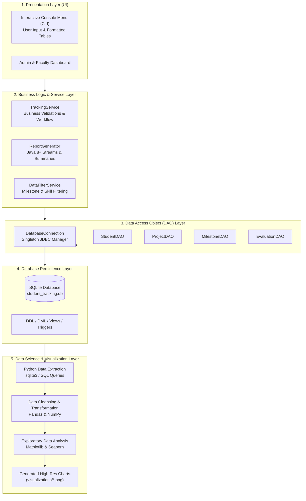
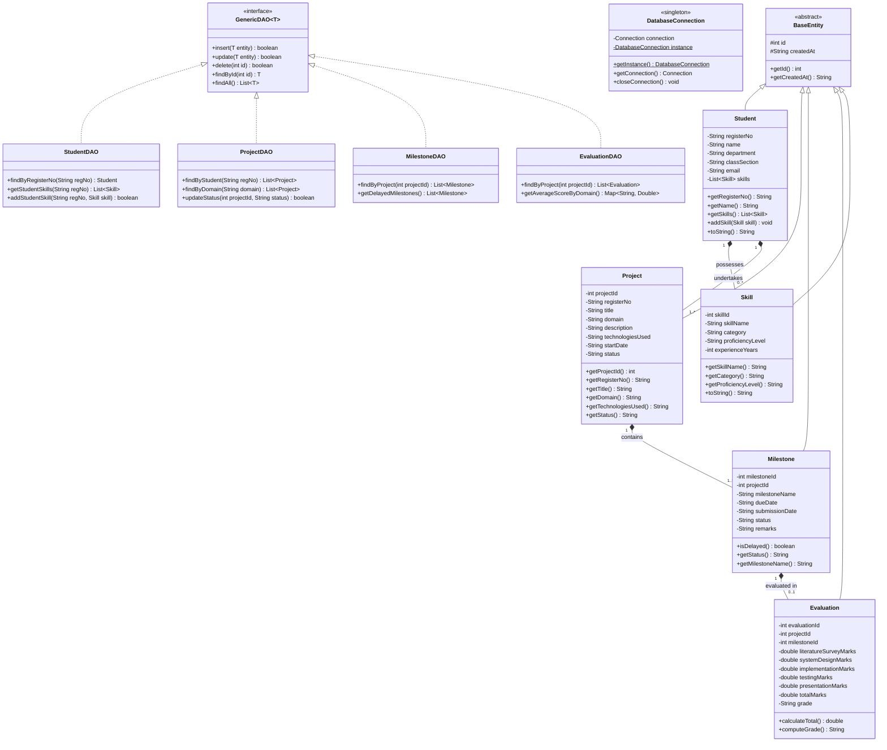
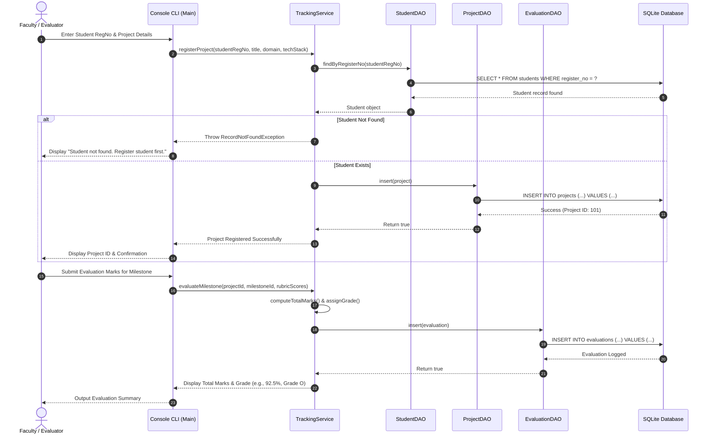
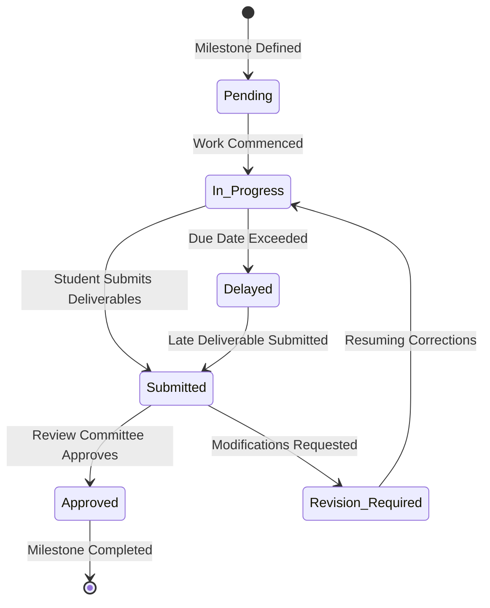

# SYSTEM DESIGN AND UML DIAGRAMS
## Student Project and Skill Tracking System

* **Student Name:** Gokul . S
* **Register Number:** 732925ITR032
* **Class:** 25IT3A
* **Department:** Information Technology
* **Institution:** Velalar College of Engineering and Technology, Erode – 12
* **Course:** 25ITT33 – Software Engineering

---

## 1. OVERALL SYSTEM ARCHITECTURE

The Student Project and Skill Tracking System adopts a **Modular N-Tier Layered Architecture**, separating user interaction, business logic, data persistence, and data intelligence.

---

## 2. USE CASE DIAGRAM

The Use Case diagram illustrates interactions between the primary actors (**Department Faculty / Project Coordinator**, **Student**, and **Data Analyst / Evaluator**) and the core system functions.

```mermaid
flowchart LR
    Faculty(("Faculty / Project Coordinator"))
    Evaluator(("Project Evaluator"))
    Analyst(("Academic Auditor / Analyst"))

    subgraph SPSTS["Student Project and Skill Tracking System"]
        UC1(["UC-1: Register Student Details"])
        UC2(["UC-2: Manage Student Skills & Proficiency"])
        UC3(["UC-3: Register Student Project & Tech Stack"])
        UC4(["UC-4: Define & Update Milestones"])
        UC5(["UC-5: Record Assessment & Component Marks"])
        UC6(["UC-6: Generate Progress & Skill Gap Reports"])
        UC7(["UC-7: Extract Data for Python Analytics"])
        UC8(["UC-8: Generate Visualizations & Insights"])
    end

    Faculty --> UC1
    Faculty --> UC2
    Faculty --> UC3
    Faculty --> UC4
    Faculty --> UC6

    Evaluator --> UC4
    Evaluator --> UC5

    Analyst --> UC6
    Analyst --> UC7
    Analyst --> UC8

    UC3 -.->|<<includes>>| UC1
    UC4 -.->|<<includes>>| UC3
    UC5 -.->|<<includes>>| UC4
    UC8 -.->|<<includes>>| UC7
```

### Use Case Specifications

| Use Case ID | Name | Actor | Pre-condition | Post-condition |
|---|---|---|---|---|
| **UC-1** | Register Student | Faculty | Faculty authenticated | Student record saved in database |
| **UC-2** | Manage Skills | Faculty | Student registered | Technical skills & proficiency mapped |
| **UC-3** | Register Project | Faculty | Student registered | Project record created with title & domain |
| **UC-4** | Update Milestones | Faculty / Evaluator | Project registered | Milestone status & submission date logged |
| **UC-5** | Record Marks | Evaluator | Milestone reached | Component scores saved & grade calculated |
| **UC-6** | Generate Reports | Faculty / Auditor | Active records exist | Formatted console report displayed |
| **UC-7** | Extract Dataset | Analyst | SQLite DB accessible | Data loaded into Pandas DataFrames |
| **UC-8** | Generate Visualizations | Analyst | Data cleaned | Charts generated and saved to disk |

---

## 3. CLASS DIAGRAM

The Class Diagram illustrates the object-oriented structure of the Java application, depicting attributes, methods, interfaces, and relationships.

---

## 4. SEQUENCE DIAGRAM: PROJECT REGISTRATION & EVALUATION WORKFLOW

---

## 5. STATE MACHINE DIAGRAM: MILESTONE LIFECYCLE

